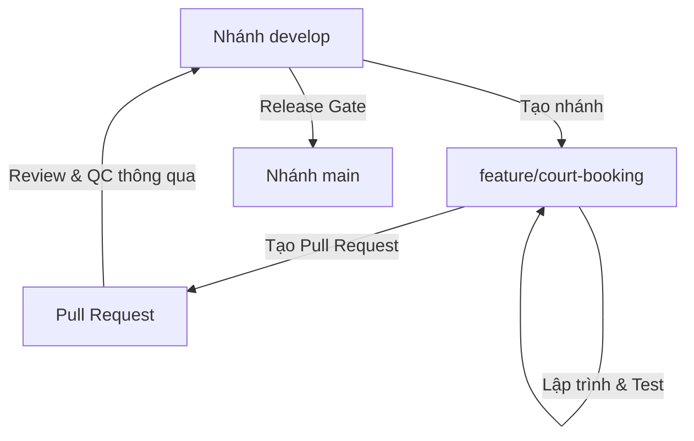

# Quy định Quản lý Nhánh (Git Branching Rules)

Tài liệu này quy định cách phân chia nhánh và luồng chuyển đổi mã nguồn (Git workflow) trong dự án **Court Management System** nhằm đảm bảo mã nguồn ổn định, sạch sẽ và hạn chế tối đa xung đột (conflict).

---

## 1. Các nhánh chính (Long-lived Branches)

Hệ thống quản lý 2 nhánh chính lâu dài:

| Nhánh | Trạng thái | Nhiệm vụ |
|---|---|---|
| `main` | Production-ready | Chứa mã nguồn ổn định nhất, đã qua kiểm thử nghiệm ngặt và sẵn sàng release. Mọi commit trên `main` đều phải được gắn nhãn phiên bản (Tag). |
| `develop` (hoặc dev) | Integration | Nhánh tích hợp chính. Các tính năng mới sau khi hoàn thành sẽ merge vào đây để test nội bộ trước khi lên stable/main. |

---

## 2. Quy tắc đặt tên nhánh phát triển (Short-lived Branches)

Mọi thay đổi code hoặc sửa lỗi đều phải được thực hiện trên một nhánh phát triển riêng biệt, tách ra từ `develop` và đặt tên theo cú pháp:

`[loại-nhánh]/[mã-task-hoặc-slug-mô-tả]`

### Các loại nhánh quy chuẩn:

1. **Tính năng mới (`feature/`)**
   - Dùng khi phát triển một module hoặc tính năng mới.
   - Ví dụ: `feature/court-slot-booking`, `feature/combo-services`
2. **Sửa lỗi (`bugfix/`)**
   - Dùng khi sửa lỗi phát hiện trong quá trình test nội bộ hoặc UAT.
   - Ví dụ: `bugfix/fix-payment-amount-rounding`
3. **Sửa lỗi khẩn cấp (`hotfix/`)**
   - Tách trực tiếp từ `main` để sửa lỗi nghiêm trọng đang xảy ra trên production.
   - Ví dụ: `hotfix/prevent-double-booking-race-condition`
4. **Tối ưu / Cải tiến (`refactor/` hoặc `chore/`)**
   - Tối ưu cấu trúc, clean code hoặc nâng cấp thư viện mà không thay đổi tính năng.
   - Ví dụ: `refactor/upgrade-efcore-10`

---

## 3. Quy trình làm việc và Merge Code



### Các bước thực hiện:

1. **Cập nhật nhánh gốc**: Luôn pull code mới nhất từ `develop` trước khi tách nhánh.
   ```bash
   git checkout develop
   git pull origin develop
   ```
2. **Tách nhánh mới**:
   ```bash
   git checkout -b feature/booking-flow
   ```
3. **Commit code**: Đảm bảo commit nhỏ gọn, tập trung và tuân thủ [Quy chuẩn Commit](file:///c:/Users/DELL/Desktop/CourtManagment/CourtManagementBE/docs/Quy%20%C4%91%E1%BB%8Bnh%20-%20Quy%20t%E1%BA%AFc/Commit.md).
4. **Tạo Pull Request (PR)**:
   - Đẩy nhánh lên remote và tạo PR về nhánh `develop`.
   - Điền đầy đủ thông tin mô tả những thay đổi đã thực hiện và checklist tự kiểm tra.
5. **Review & Merge**:
   - Ít nhất 1 developer hoặc AI lead review mã nguồn.
   - Chạy linter/format đạt 100% trước khi merge.
