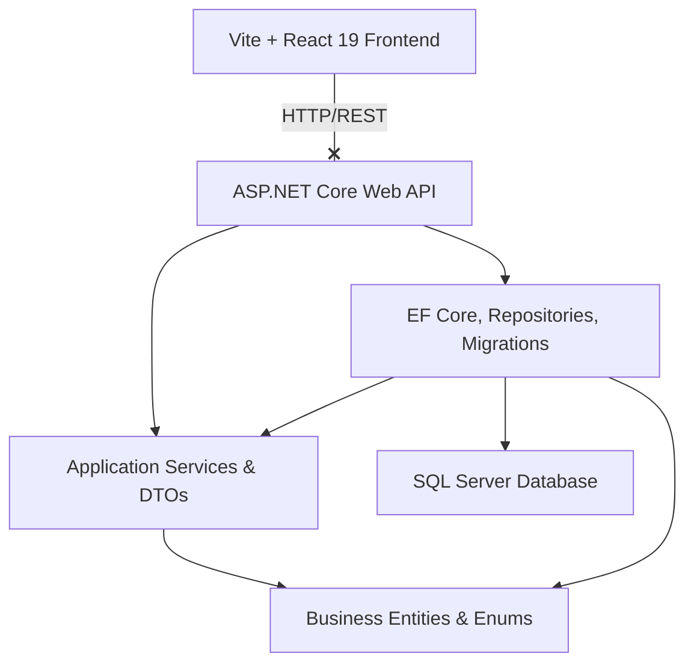

# Kiến trúc Hệ thống (System Architecture)

Dự án **Court Management System** được thiết kế theo cấu trúc tách biệt giữa **Backend API (.NET 10)** và **Frontend ClientApp (React 19)** kết hợp cơ sở dữ liệu **SQL Server**.

---

## 1. Sơ đồ Kiến trúc Tổng thể



---

## 2. Backend Clean Architecture Projects

Phần backend (.NET 10.0) bao gồm 4 project riêng biệt tổ chức theo kiến trúc Clean Architecture:

### 📂 [Domain Project](file:///c:/Users/DELL/Desktop/CourtManagment/CourtManagementBE/CourtManagementBE.Domain)
Chứa các thực thể nghiệp vụ (Domain Entities) nguyên bản và các định nghĩa dùng chung. Không phụ thuộc vào bất kỳ thư viện ngoài nào (trừ một số EF Core Core Attributes cơ bản).
- `Abstractions/`: Các lớp trừu tượng nền tảng (ví dụ: `AuditableEntity.cs`).
- `Constants/`: Khai báo các hằng số dùng chung của tầng domain.
- `Entities/`: Định nghĩa thực thể database (`Bookings.cs`, `Courts.cs`, `Payments.cs`).
- `Enums/`: Các kiểu liệt kê (trạng thái booking, phân loại sân...).
- `Models/`: Các class phục vụ phân trang dữ liệu (`PagingSpecification.cs`, `PageList.cs`).

### 📂 [Application Project](file:///c:/Users/DELL/Desktop/CourtManagment/CourtManagementBE/CourtManagementBE.Application)
Chứa các interface và implement logic nghiệp vụ chính (Business Logic), các đối tượng truyền nhận dữ liệu DTO và mapper.
- `Common/`: Response bọc chuẩn (`Result.cs`), `BaseService.cs` và repository interfaces chung (`IGenericRepository.cs`).
- `DTOs/`: Chứa các model Request/Response trao đổi với API.
- `Extensions/` & `Helpers/`: Các hàm tiện ích bổ trợ tính toán hoặc serialize dữ liệu.
- `IRepositories/` & `IServices/`: Định nghĩa các contract giao tiếp.
- `Profiles/`: Cấu hình chuyển đổi dữ liệu AutoMapper (`MappingProfile.cs`).
- `Services/`: Nơi triển khai logic nghiệp vụ chính (`BookingService.cs`, `AreaService.cs`).

### 📂 [Infrastructure Project](file:///c:/Users/DELL/Desktop/CourtManagment/CourtManagementBE/CourtManagementBE.Infrastructure)
Chứa cài đặt cụ thể liên quan tới hạ tầng kỹ thuật: EF Core, Repositories, Migrations, và stored procedures.
- `Common/`: Bộ điều phối giao dịch (`UnitOfWork.cs`).
- `Data/`: `AppDbContext.cs` của EF Core, seeder dữ liệu (`AppDbSeeder.cs`) và EF Interceptors (như `AuditInterceptor.cs` tự động cập nhật người tạo/sửa).
- `Migrations/`: Lưu vết lịch sử thay đổi cấu trúc bảng database.
- `Repositories/`: Các repository thực thi truy vấn trực tiếp vào database.
- `SqlScripts/`: Thư mục lưu các file script Stored Procedure/View dưới dạng file SQL thô, tự động chạy nạp vào DB khi start app.

### 📂 [Web API Project](file:///c:/Users/DELL/Desktop/CourtManagment/CourtManagementBE/CourtManagementBE.Api)
Tầng chạy ứng dụng, xử lý định tuyến (Routing), Middleware và Controller.
- `Controllers/`: Nhận request, gọi Service tương ứng để xử lý và trả về API.
- `Middlewares/`: Pipeline xử lý request: Global exception, logging, validation.
- `Program.Program.cs`: File cấu hình khởi động chính (DI Container, Config, Logging).

---

## 3. Frontend Project Layout (`ClientApp`)

Frontend đặt tại `CourtManagementBE.Api/ClientApp` được phát triển trên React 19 và Vite, tổ chức dạng feature-based layout:

```text
ClientApp/
├── public/                 # Static assets (favicons, v.v.)
├── src/
│   ├── app/                # Cấu hình router và context bọc ngoài app
│   ├── assets/             # Media tĩnh (images, logos)
│   ├── components/         # Các UI components dùng chung (LoadingSpin, Button...)
│   ├── config/             # Cấu hình Client
│   ├── constants/          # Khai báo các key lưu trữ (LocalStorage key...)
│   ├── features/           # Cấu trúc module riêng biệt (api client + query hooks)
│   ├── hooks/              # Custom React hooks dùng chung toàn app
│   ├── layouts/            # Layout chính (Sidebar, Header, LayoutAdmin...)
│   ├── pages/              # Nơi chứa view hiển thị tương ứng với route
│   ├── services/           # ApiClient cấu hình Axios và Storage wrapper
│   ├── store/              # Cấu hình Redux Toolkit (nếu có)
│   ├── styles/             # Cấu hình style (CSS, Tailwind v4, Antd theme)
│   ├── types/              # Định nghĩa typescript models
│   └── utils/              # Hàm bổ trợ (Format ngày, parse lỗi...)
```

### Cơ chế phân chia Feature:
Mỗi chức năng chính trong `src/features/` (ví dụ: `bookings`, `areas`) sẽ bao gồm:
- **`api/`**: Nơi viết call API (ví dụ: `bookingApi.ts`) và khai báo custom hook React Query (ví dụ: `useBookingQueries.ts`). Tránh viết raw Axios trực tiếp tại component trang UI.
- **`model/`**: Định nghĩa types/interface riêng cho feature.
