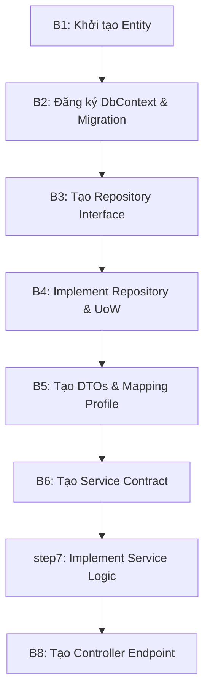

# Hướng dẫn Phát triển Module Backend Mới (8 Bước Chuẩn)

Quy trình phát triển một tính năng hoặc module nghiệp vụ mới trong backend của **Court Management System** tuân thủ cấu trúc phân tầng nghiêm ngặt dưới đây nhằm giữ vững tính cô lập và cấu trúc Clean Architecture.

---

## Tóm tắt 8 Bước Quy chuẩn



---

## Chi tiết từng bước thực hiện

### Bước 1: Khởi tạo thực thể (Domain Entity)
Tạo tệp class mới trong project `.Domain` tại `Entities/` kế thừa từ `AuditableEntity` (để tự động thu thập thông tin người tạo/ngày tạo qua Interceptor):
```csharp
namespace CourtManagementBE.Domain.Entities;

public class FeatureNote : AuditableEntity
{
    public int Id { get; set; }
    public string Title { get; set; } = null!;
    public string Content { get; set; } = null!;
    public int FacilityId { get; set; }
}
```

### Bước 2: Đăng ký DbContext và tạo Migration
- Thêm thuộc tính `DbSet` vào `AppDbContext.cs`:
  ```csharp
  public DbSet<FeatureNote> FeatureNotes { get; set; } = null!;
  ```
- Chạy lệnh Migration ở terminal thư mục root:
  ```bash
  dotnet ef migrations add AddFeatureNoteTable --project CourtManagementBE.Infrastructure --startup-project CourtManagementBE.Api
  dotnet ef database update --project CourtManagementBE.Infrastructure --startup-project CourtManagementBE.Api
  ```

### Bước 3: Tạo Repository Interface
Khai báo interface tại `.Application` tại thư mục `IRepositories/` kế thừa từ `IGenericRepository<T>`:
```csharp
using CourtManagementBE.Domain.Entities;

namespace CourtManagementBE.Application.IRepositories;

public interface IFeatureNoteRepository : IGenericRepository<FeatureNote>
{
    // Thêm các hàm truy vấn đặc thù (nếu có)
}
```

### Bước 4: Triển khai Repository & Đăng ký vào Unit of Work
- Cài đặt Repository tại `.Infrastructure` tại `Repositories/`:
  ```csharp
  using CourtManagementBE.Domain.Entities;
  using CourtManagementBE.Application.IRepositories;
  using CourtManagementBE.Infrastructure.Data;

  namespace CourtManagementBE.Infrastructure.Repositories;

  public class FeatureNoteRepository : GenericRepository<FeatureNote>, IFeatureNoteRepository
  {
      public FeatureNoteRepository(AppDbContext context) : base(context) { }
  }
  ```
- Khai báo thuộc tính trong `IUnitOfWork.cs` và gán triển khai tương ứng trong `UnitOfWork.cs`.

### Bước 5: Tạo DTOs và Cấu hình AutoMapper
- Tạo model Request/Response tại `.Application` tại `DTOs/`.
- Mở `MappingProfile.cs` đăng ký ánh xạ Map:
  ```csharp
  CreateMap<FeatureNote, FeatureNoteResponse>();
  CreateMap<FeatureNoteRequest, FeatureNote>();
  ```

### Bước 6: Tạo Service Contract
Tạo interface Service tại `.Application` tại `IServices/`:
```csharp
using CourtManagementBE.Application.Common;
using CourtManagementBE.Application.DTOs;

namespace CourtManagementBE.Application.IServices;

public interface IFeatureNoteService
{
    Task<Result<FeatureNoteResponse>> GetById(int id);
    Task<Result<FeatureNoteResponse>> Create(FeatureNoteRequest req);
}
```

### Bước 7: Thực hiện viết Code xử lý (Service Logic)
Cài đặt service tại `.Application` tại `Services/`, tuân thủ cấu trúc logging Tiếng Việt và bọc response `Result<T>`:
```csharp
namespace CourtManagementBE.Application.Services;

public class FeatureNoteService : BaseService, IFeatureNoteService
{
    private readonly IUnitOfWork _unitOfWork;
    private readonly ILogger<FeatureNoteService> _logger;

    public FeatureNoteService(IUnitOfWork unitOfWork, IMapper mapper, ILogger<FeatureNoteService> logger) : base(mapper)
    {
        _unitOfWork = unitOfWork;
        _logger = logger;
    }

    public async Task<Result<FeatureNoteResponse>> Create(FeatureNoteRequest req)
    {
        const string loggingHeader = "Tạo ghi chú tính năng";
        
        var entity = _mapper.Map<FeatureNote>(req);
        _unitOfWork.IFeatureNoteRepository.Add(entity);
        await _unitOfWork.SaveChangesAsync();

        var res = _mapper.Map<FeatureNoteResponse>(entity);
        { _logger.LogInformation($"{loggingHeader} - Thành công. ID: {entity.Id}"); return Success(res, "Tạo thành công."); }
    }
}
```

### Bước 8: Tạo Controller API Endpoint
Tạo controller tại `.Api` tại `Controllers/` kế thừa `ControllerBase` bọc attribute `[Authorize]` và `[ApiController]`:
```csharp
namespace CourtManagementBE.Api.Controllers;

[ApiController]
[Route("api/[controller]")]
[Authorize]
public class FeatureNoteController : ControllerBase
{
    private readonly IFeatureNoteService _service;
    public FeatureNoteController(IFeatureNoteService service)
    {
        _service = service;
    }

    [HttpPost]
    public async Task<IActionResult> Create([FromBody] FeatureNoteRequest req)
    {
        var r = await _service.Create(req);
        return StatusCode((int)r.StatusCode, r);
    }
}
```
*Đừng quên đăng ký Service và Repository tương ứng trong tầng DI (`Program.cs` hoặc `ServiceExtensions.cs` nếu có).*
