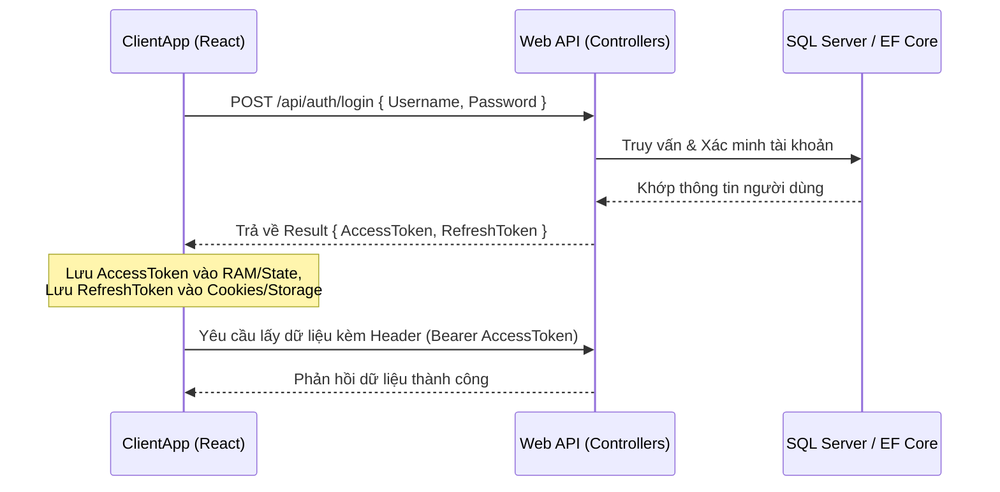
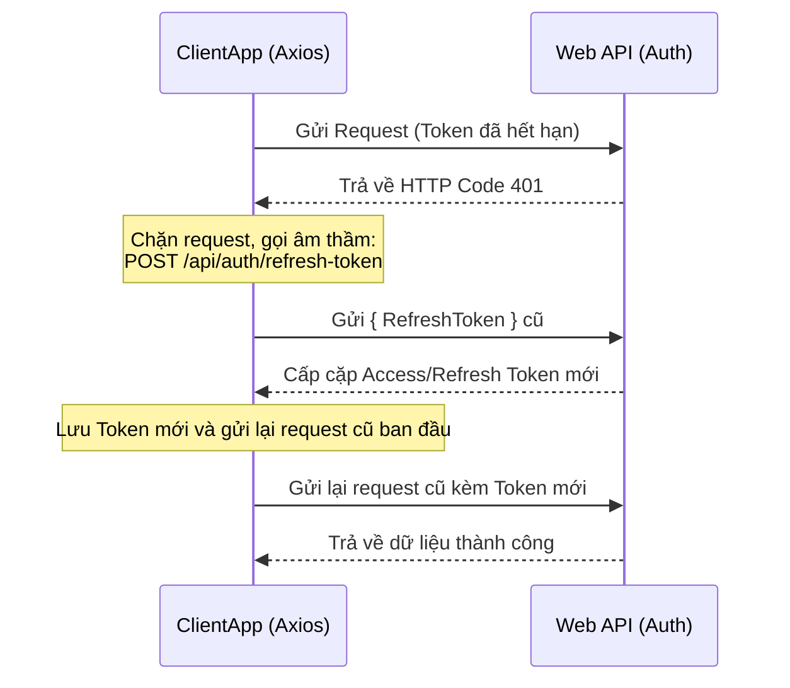

# Luồng kỹ thuật Xác thực (Authentication & Authorization Flow)

Hệ thống Court Management System sử dụng cơ chế xác thực không trạng thái (Stateless Authentication) qua **JSON Web Token (JWT)** phối hợp với **Refresh Token** để duy trì phiên đăng nhập của người dùng.

---

## 1. Sơ đồ luồng Xác thực

---

## 2. Luồng Gia hạn tự động (Refresh Token Flow)

Khi Access Token hết hạn (hạn dùng mặc định là 60 phút), Axios Interceptor trên client sẽ tự động bắt mã lỗi `401 Unauthorized` và thực hiện xin cấp mới token ngầm mà không làm ngắt quãng trải nghiệm của người dùng:

---

## 3. Vai trò phân quyền (Authorization RBAC)

Hệ thống phân chia quyền hạn dựa trên Role gắn với tài khoản người dùng:
- **`[Authorize(Roles = "Admin")]`**: Toàn quyền cấu hình hệ thống, tạo cơ sở, khu vực, cài đặt giá sân.
- **`[Authorize(Roles = "Staff")]`**: Nhân viên vận hành, check-in khách hàng, khóa sân đột xuất, hỗ trợ đặt sân tại quầy.
- **`[Authorize]` (Không chỉ định role)**: Khách hàng đã đăng ký tài khoản, được phép xem lịch sử đặt sân cá nhân và tạo booking.
- **Public**: Xem danh sách cơ sở, thông tin sân trống để chuẩn bị đặt lịch.
