# Luồng kỹ thuật Đặt sân & Chặn Trùng lịch (Slot Booking Flow)

Để đảm bảo không xảy ra hiện tượng hai người dùng cùng đặt một sân ở cùng một khung giờ tại cùng thời điểm (Race Condition), hệ thống thiết lập quy trình kiểm tra và khóa lịch chặt chẽ.

---

## 1. Sơ đồ Luồng Đặt sân (Booking Sequence)

```mermaid
sequenceDiagram
    participant FE as ClientApp
    participant BE as Web API
    participant DB as SQL Server (Transaction)

    FE->>BE: GET /api/booking-slot/availability?courtId=X&date=Y
    BE->>DB: Chạy SP_GetCourtSlotAvailability
    DB-->>BE: Danh sách slots khả dụng (0/1)
    BE-->>FE: Hiển thị Grid chọn giờ chơi
    
    FE->>BE: POST /api/booking (Chọn Slot, Gửi Idempotency-Key)
    Note over BE: Khởi tạo DB Transaction
    BE->>DB: Kiểm tra lại xem Slot đã bị ai đặt chưa
    alt Slot đã bị đặt
        DB-->>BE: Trả về cờ Trùng lịch
        BE-->>FE: Trả lỗi "Khung giờ này đã có người đặt" (400)
    else Slot còn trống
        BE->>DB: Insert Booking & BookingSlots (Chiếm giờ)
        DB-->>BE: Commit Transaction
        BE-->>FE: Trả kết quả Tạo Booking thành công
    end
```

---

## 2. Các Cơ chế Bảo vệ Tránh đặt trùng sân

Hệ thống áp dụng 3 lớp bảo vệ:

1. **Idempotency-Key ở Client**:
   - Khi bấm "Xác nhận đặt sân", client đính kèm `Idempotency-Key` (UUID). Nếu người dùng nhấn đúp nút do mạng chậm, request thứ 2 sẽ bị chặn lại ngay tại API Gateway/Middleware và trả về kết quả của request thứ nhất, không thực hiện insert 2 lần vào database.
2. **Giao dịch Database (Database Transaction isolation)**:
   - Các API ghi đè lịch sử đặt sân được bọc trong một `UnitOfWork` Transaction. Khi chạy lệnh thêm giờ chơi vào bảng `BookingSlots`, hệ thống khóa tạm thời dòng dữ liệu liên quan để các transaction khác phải xếp hàng chờ.
3. **Stored Procedure kiểm tra nguyên tử**:
   - Khi đặt lịch định kỳ (Recurring bookings), stored procedure `005_sp_CreateRecurringBookingGroup` sẽ thực hiện quét toàn bộ chu kỳ ngày tháng trong tương lai. Nếu phát hiện bất kỳ một ngày nào bị trùng slot trước đó, toàn bộ giao dịch sẽ bị Rollback để đảm bảo tính nhất quán (không xảy ra tình trạng đặt lịch thành công một nửa).
