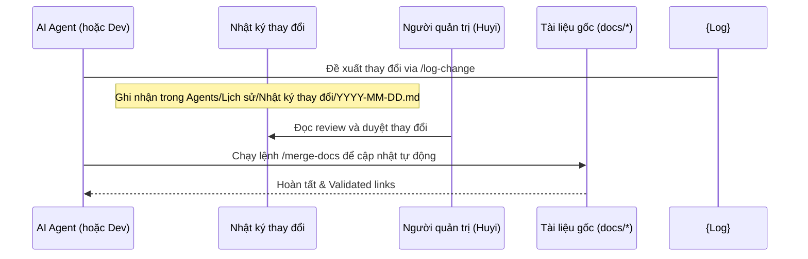

# Quy trình cập nhật tài liệu (Documentation Update Workflow)

Để ngăn chặn việc tài liệu bị trôi (documentation drift) và lỗi thời so với mã nguồn thực tế, mọi thành viên và AI Agent tham gia phát triển dự án **Court Management System** bắt buộc phải tuân thủ quy trình **đề xuất - phê duyệt - áp dụng** dưới đây.

---

## 1. Chu trình cập nhật tài liệu an toàn

Tuyệt đối không chỉnh sửa trực tiếp các tệp tài liệu gốc trong thư mục `docs/`. Hãy thực hiện qua 3 bước:



---

## 2. Bước 1: Ghi vết thay đổi (`/log-change`)
Khi có thay đổi về tính năng, cấu hình hoặc phát hiện sai sót trong tài liệu:
1. Chạy lệnh `/log-change <mô tả>` hoặc chỉnh sửa file nhật ký tại `Agents/Lịch sử/Nhật ký thay đổi/YYYY-MM-DD.md`.
2. Định dạng mỗi mục ghi nhận phải chỉ rõ file đích và nội dung thay đổi dưới dạng diff:
   ```markdown
   - [ ] Target: [Quy ước.md](file:///c:/Users/DELL/Desktop/CourtManagment/CourtManagementBE/docs/T%C3%A0i%20li%E1%BB%87u%20k%E1%BB%B9%20thu%E1%BA%ADt/Quy%20%C6%B0%E1%BB%9Bc.md)
     - Detail: Thêm hướng dẫn ghi log tiếng Việt.
     - Change Proposed:
       ```diff
       + Hằng số loggingHeader bắt buộc dùng tiếng Việt.
       ```
   ```

---

## 3. Bước 2: Duyệt và Áp dụng (`/merge-docs`)
Sau khi người quản lý (Huyi) xem xét và duyệt các dòng `[ ]` trong tệp nhật ký thay đổi:
1. Nhà phát triển hoặc AI Agent chạy công cụ `/merge-docs`.
2. Hệ thống sẽ tự động phân tích cú pháp file nhật ký, xác định các checkbox trống, áp dụng sự thay đổi vào các file tài liệu tương ứng trong `docs/` và đánh dấu lại thành `[x]` (hoàn thành).
